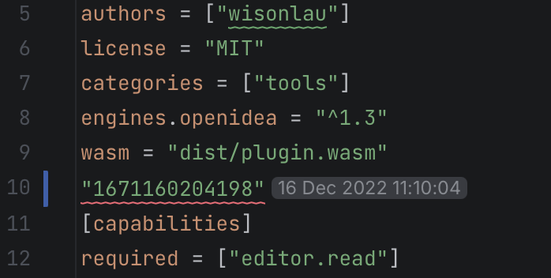

# Unix Timestamp Converter for OpenIDEA

在编辑器中把 Unix 时间戳就地翻译成可读日期的 OpenIDEA 插件。


## 功能

- **内嵌提示（inlay hints）**：在时间戳旁显示日期。按位数自动识别单位：10 位秒、13 位毫秒、16 位微秒、19 位纳秒，支持 Java 的 `l/L` 后缀与小数时间戳。带单词边界检查，且要求换算年份在 2000–2100，避免把 IP 地址、端口号等普通数字误转。
- **插入当前时间戳**：命令 `Unix Timestamp: Insert Current Timestamp`（⌘⇧A 搜索），在所有光标处插入当前毫秒级时间戳。
- **可配置**：日期格式（Java SimpleDateFormat 风格，默认 `dd MMM yyyy HH:mm:ss`）、时区（UTC / 固定偏移如 `+08:00` / 留空用系统时区）、提示位置（行尾或数字后）、微秒/纳秒识别开关。

示例：`1640970000`（秒）→ `01 Jan 2022 08:00:00`（UTC+8）；`1671160204198`（毫秒）→ `16 Dec 2022 11:10:04`（UTC+8）。

## 能力说明

插件申请两项编辑器能力，均为低风险，不涉及网络、进程或文件系统：

- `editor.read`：读取当前聚焦编辑器的文档内容与可见范围，用于扫描时间戳、确定内嵌提示的显示位置。
- `editor.write`：仅用于「插入当前时间戳」命令——通过 `transform_selections` 在每个光标处插入当前毫秒级时间戳，不直接读写磁盘文件。内嵌提示功能本身不需要此项能力。

插件代码运行在 WebAssembly 沙箱中，除上述能力外无法访问系统资源。

## 构建与测试

需要 Rust（含 `wasm32-wasip2` target）和 `openidea-plugin` CLI：

```bash
cargo test                      # 单元测试，15 条
openidea-plugin build           # 编译 wasm 到 dist/plugin.wasm 并校验
```

SDK 依赖绑定 OpenIDEA v0.1.50 tag，对应插件 API 1.14。

## 本地开发

```bash
openidea-plugin link            # 链接到本机 IDE，无需安装
# 在 设置 › 插件 中授权后即可使用；改动后执行 build 再点「从磁盘重新加载」
```

## 许可证

MIT，见 [LICENSE](LICENSE)。
